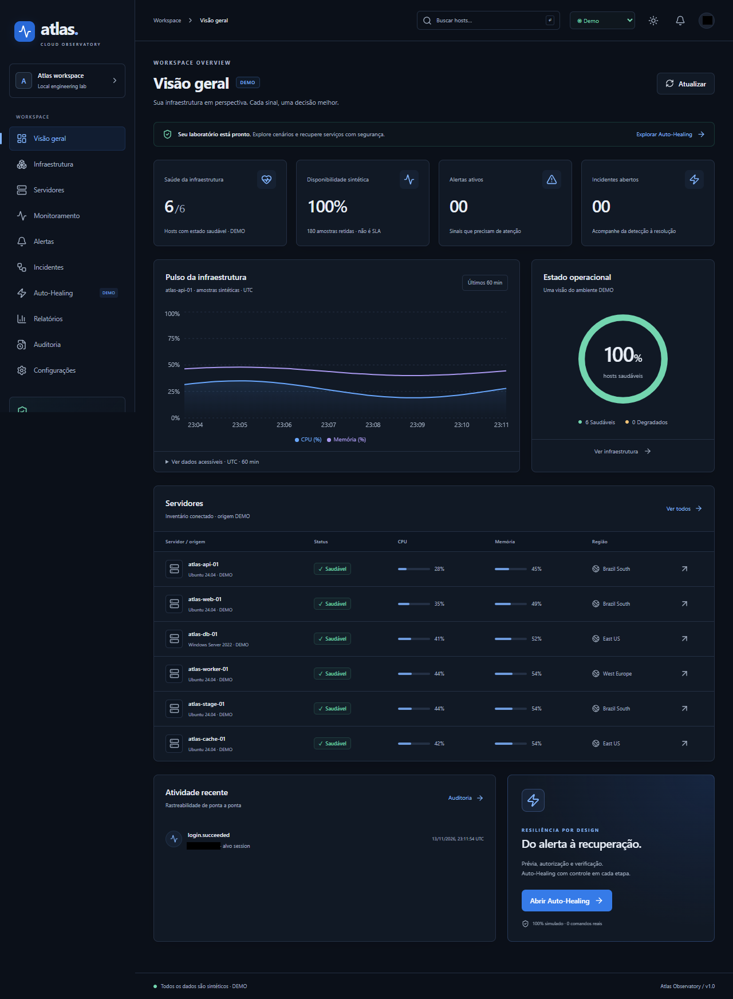
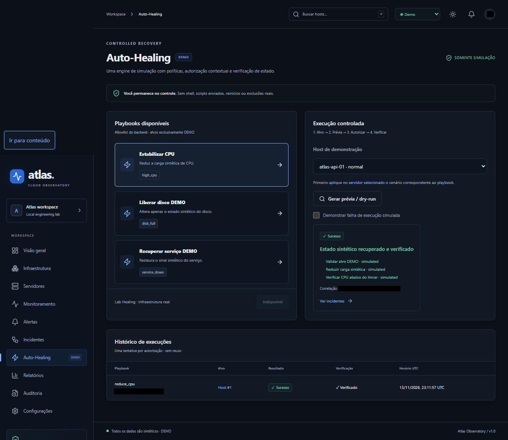
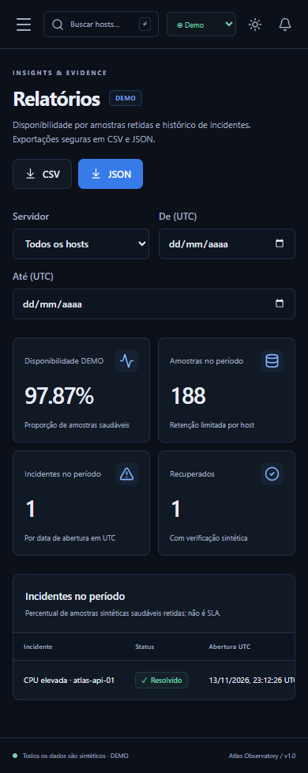

# Atlas Cloud Observatory

[Português](README.md)

**From metrics to incidents, from decisions to simulated recovery.**

Atlas Cloud Observatory is an observability laboratory that demonstrates infrastructure, DevOps and SRE concepts through an integrated local application. It connects inventory, signals, alerts, incidents and simulated recovery, with explicit authorization and verification steps.

**V1 uses synthetic data exclusively. It does not perform real monitoring, access servers or operate infrastructure.**

## What the project demonstrates

- A connected view of health, inventory and history for demonstration hosts.
- Synthetic CPU, memory, disk, network and service-state metrics.
- Time-based detection rules and an alert-to-incident lifecycle.
- Playbook previews, contextual authorization and simulated recovery only.
- Synthetic-state verification, an audit trail and exportable reports.
- An interface with light/dark themes, filters and tabular alternatives to charts.

The goal is to make the connection between observation, decisions and evidence visible without requiring live cloud infrastructure.

## Technologies

| Layer | Technologies used by the reference application |
|---|---|
| Interface | React, TypeScript, Vite, Tailwind CSS and Recharts |
| Navigation and data | React Router, TanStack Query, React Hook Form and Zod |
| API and domain | Python, FastAPI and Pydantic |
| Persistence | SQLAlchemy, Alembic and SQLite |
| Historical validation | pytest/httpx, Vitest/Testing Library, Playwright, Ruff and ESLint/TypeScript |

## Architecture in one sentence

The interface communicates with a local API that applies domain rules, preserves history and coordinates simulation; authorization is enforced by the backend, and results feed the incident timeline and evidence trail.

[Explore the conceptual architecture](docs/ARCHITECTURE.md).

## One demonstration, one complete flow

**Observe a DEMO host → apply a synthetic fault → review the alert and incident → inspect the preview → authorize simulation → verify recovery → inspect audit records and reports.**

Documented scenarios include normal operation, high CPU, full disk and unavailable service. None of these faults is induced on the real machine. The [demonstration guide](docs/DEMO.md) describes the flow and its boundaries.

## Historical evidence

The report dated 13 November 2026 records **46 backend tests, eight frontend tests and one end-to-end flow passing**, alongside lint and build checks. These figures describe that run and **do not represent tests rerun for this documentation edition**. See the [historical summary](docs/HISTORICAL_VALIDATION.md).

## Explore

- [Features](docs/FEATURES.md)
- [Architecture](docs/ARCHITECTURE.md)
- [Demonstration](docs/DEMO.md)
- [Historical validation](docs/HISTORICAL_VALIDATION.md)
- [Limitations](docs/LIMITATIONS.md)
- [Technologies and credits](CREDITS.md)

## Scope

This portfolio presents the work conceptually; it does not distribute the implementation or provide a hosted service. Azure Monitor, real collection and Lab Healing are not implemented. Laboratory availability is based on synthetic samples, not an SLA. V1 has not been approved for production use.

## Demonstration screenshots

The three screenshots below show **synthetic DEMO data**. Operational identifiers were covered with opaque bars; metrics and outcomes were preserved. The copies passed technical integrity and redaction checks. Publication of this material requires the owner’s explicit authorization. They do not demonstrate real monitoring or production readiness.

### Overview

### Simulated recovery

### Mobile reports

