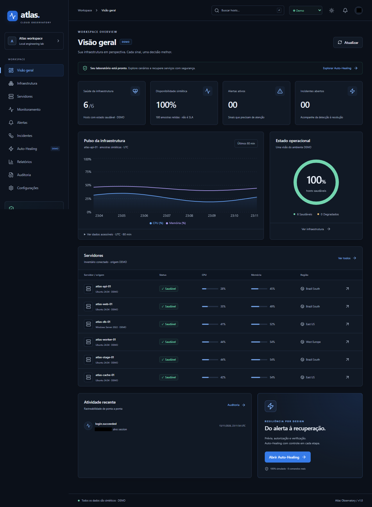
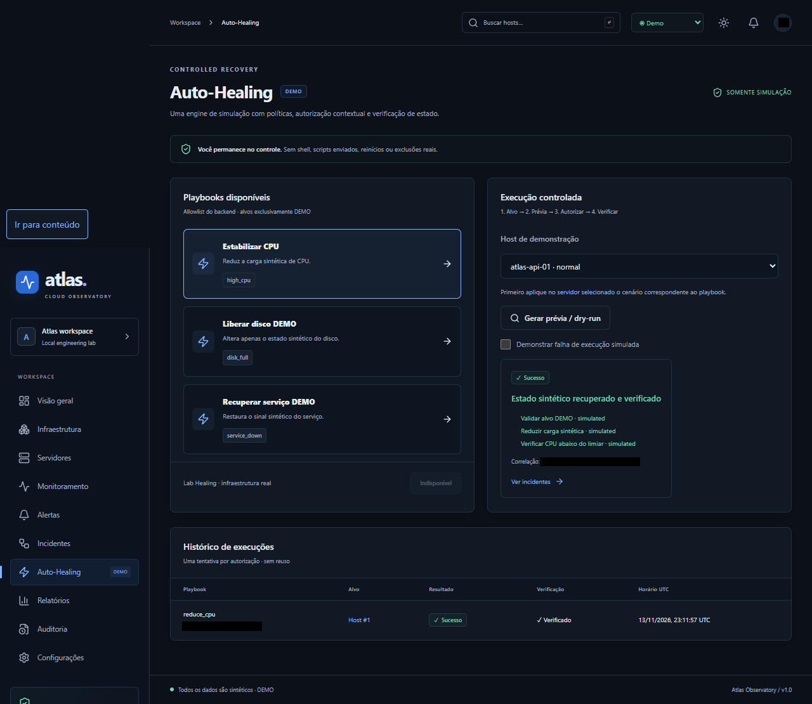
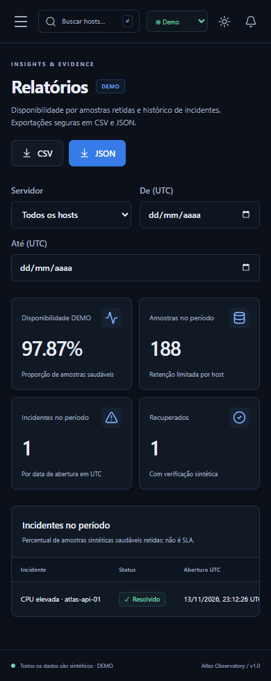

# Atlas Cloud Observatory

[English](README.en.md)

**Da métrica ao incidente, da decisão à recuperação simulada.**

Atlas Cloud Observatory é um laboratório de observabilidade para demonstrar conceitos de infraestrutura, DevOps e SRE em uma aplicação local integrada. O projeto conecta inventário, sinais, alertas, incidentes e recuperação simulada, com etapas explícitas de autorização e verificação.

**A V1 utiliza exclusivamente dados sintéticos. Não realiza monitoramento real, acesso a servidores ou operações de infraestrutura.**

## O que o projeto demonstra

- Uma visão conectada de saúde, inventário e histórico de hosts de demonstração.
- Métricas sintéticas de CPU, memória, disco, rede e estado de serviço.
- Detecção por regras temporais e acompanhamento do ciclo de alertas e incidentes.
- Prévia de playbooks, autorização contextual e recuperação exclusivamente simulada.
- Verificação de estado sintético, trilha de auditoria e relatórios exportáveis.
- Interface com temas claro/escuro, filtros e alternativa tabular para gráficos.

O objetivo é tornar visível o encadeamento entre observação, decisão e evidência, sem exigir uma infraestrutura cloud real.

## Tecnologias

| Camada | Tecnologias utilizadas na aplicação de referência |
|---|---|
| Interface | React, TypeScript, Vite, Tailwind CSS e Recharts |
| Navegação e dados | React Router, TanStack Query, React Hook Form e Zod |
| API e domínio | Python, FastAPI e Pydantic |
| Persistência | SQLAlchemy, Alembic e SQLite |
| Validação histórica | pytest/httpx, Vitest/Testing Library, Playwright, Ruff e ESLint/TypeScript |

## Arquitetura em uma frase

A interface consulta uma API local que aplica regras de domínio, conserva o histórico e coordena a simulação; a autorização é verificada no backend, e o resultado retorna à trilha de incidentes e evidências.

[Conheça a arquitetura conceitual](docs/ARCHITECTURE.md).

## Uma demonstração, um fluxo completo

**Observar host DEMO → aplicar falha sintética → analisar alerta e incidente → revisar prévia → autorizar simulação → verificar recuperação → consultar auditoria e relatório.**

Os cenários documentados incluem operação normal, CPU elevada, disco cheio e serviço indisponível. Nenhuma dessas falhas é provocada na máquina real. O [roteiro de demonstração](docs/DEMO.md) explica as etapas e os limites.

## Evidência histórica

O relatório de 13 de novembro de 2026 registra **46 testes backend, oito frontend e um fluxo E2E aprovados**, além de lint e build aprovados. Esses números descrevem aquela execução e **não representam testes repetidos nesta edição documental**. Veja o [resumo histórico](docs/HISTORICAL_VALIDATION.md).

## Explore

- [Funcionalidades](docs/FEATURES.md)
- [Arquitetura](docs/ARCHITECTURE.md)
- [Demonstração](docs/DEMO.md)
- [Validação histórica](docs/HISTORICAL_VALIDATION.md)
- [Limitações](docs/LIMITATIONS.md)
- [Tecnologias e créditos](CREDITS.md)

## Escopo

Este portfólio apresenta o trabalho em nível conceitual; não distribui a implementação nem oferece um serviço hospedado. Azure Monitor, coleta real e Lab Healing não estão implementados. A disponibilidade exibida no laboratório é calculada sobre amostras sintéticas, não corresponde a SLA. A V1 não está homologada para produção.

## Capturas da demonstração

As três capturas abaixo apresentam **dados sintéticos DEMO**. Identificadores operacionais foram ocultados com tarjas opacas; métricas e resultados foram preservados. A integridade e as tarjas destas cópias foram verificadas tecnicamente. A publicação deste material depende de autorização explícita do responsável. Não representam monitoramento real nem homologação para produção.

### Visão geral

### Recuperação simulada

### Relatórios mobile

