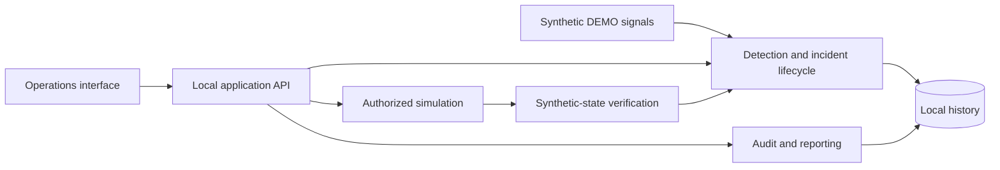

# Arquitetura conceitual / Conceptual architecture

[Português](../README.md) · [English](../README.en.md)

## Português

O desenho separa apresentação, regras de domínio, simulação e persistência. A interface apoia a decisão humana; a API valida as operações e coordena seu resultado. Os sinais de demonstração alimentam regras que conectam detecção, análise e resolução.

A recuperação é uma mudança de estado sintético precedida por prévia e autorização. Sua verificação permite acompanhar o resultado no histórico de incidentes. A auditoria e os relatórios tornam as etapas consultáveis.

React e TypeScript compõem a apresentação. FastAPI e Pydantic sustentam a API. SQLAlchemy, Alembic e SQLite fornecem persistência local e migrações. O diagrama apresenta responsabilidades, não endpoints, esquema de banco ou detalhes de implementação.

Não há conexão com servidores ou serviços cloud reais. Uma integração futura exigiria desenho, autorização e validação próprios; não faz parte da V1.

## English

The design separates presentation, domain rules, simulation and persistence. The interface supports human decisions; the API validates operations and coordinates their results. Demonstration signals feed rules that connect detection, analysis and resolution.

Recovery is a synthetic-state change preceded by a preview and authorization. Verification makes the outcome visible in incident history. Audit records and reports make the steps reviewable.

React and TypeScript provide presentation. FastAPI and Pydantic support the API. SQLAlchemy, Alembic and SQLite provide local persistence and migrations. The diagram describes responsibilities, not endpoints, database schemas or implementation internals.

No live servers or cloud services are connected. A future integration would require its own design, authorization and validation; it is outside V1.
